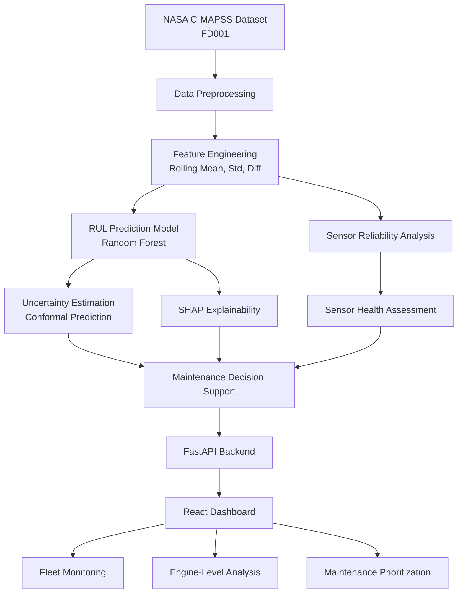

# PredictX AI

### Reliability-Aware and Uncertainty-Driven Predictive Maintenance System

PredictX AI is a machine learning-based predictive maintenance system designed to estimate Remaining Useful Life (RUL) and assess prediction reliability under imperfect sensor conditions.

## Key Features

- Remaining Useful Life prediction
- Sensor reliability assessment
- Robust training under sensor corruption
- Uncertainty estimation using conformal prediction
- SHAP-based explainability
- Maintenance decision support
- FastAPI backend and React dashboard
- Docker-based deployment

## Technology Stack

| Area | Technologies |
|---|---|
| Programming | Python, JavaScript |
| Machine Learning | Scikit-learn, XGBoost |
| Data Processing | Pandas, NumPy |
| Explainability | SHAP |
| Backend | FastAPI |
| Frontend | React, Vite, Recharts |
| Deployment | Docker, Docker Compose |
| Testing | Pytest |

## Dataset

NASA C-MAPSS turbofan engine degradation dataset, FD001 subset.

This is simulated data, not real industrial sensor data.

## Baseline Model Results

| Model | MAE | RMSE | R2 |
|---|---:|---:|---:|
| Random Forest | 23.52 | 31.85 | 0.765 |
| XGBoost | 23.98 | 32.16 | 0.760 |
| Linear Regression | 25.18 | 31.69 | 0.767 |

Robust training experiments show scenario-dependent trade-offs between clean-data accuracy and performance under sensor corruption.

## Project Structure

- app/ — FastAPI backend
- frontend/ — React dashboard
- src/ — ML source code
- data/ — Dataset and processed data
- models/ — Locally stored trained models
- reports/ — Evaluation and explainability reports
- notebook/ — Experiment notebooks
- tests/ — API tests

## Run Locally

### Backend

```bash
python -m uvicorn app.main:app --reload
```

### Frontend

```bash
cd frontend
npm ci
npm run dev
```

### Docker

```bash
docker compose up -d --build
```

Frontend: http://localhost:5173

API documentation: http://localhost:5173/docs

## Testing

```bash
python -m pytest tests/ -v
```

## Limitations

- Experiments use the FD001 subset.
- Sensor health scores are rule-based indicators, not calibrated physical failure probabilities.
- Maintenance thresholds are prototype rules.
- Uncertainty coverage depends on the calibration and evaluation protocol.
- This is a research and engineering prototype, not a certified industrial maintenance system.

## Future Improvements

- Independent calibration and evaluation
- Additional operating conditions and datasets
- Model drift monitoring
- Production-grade deployment and security

## Author

AI/ML Engineering Portfolio Project

## Application Preview

## System Architecture



### Fleet Command Center


### Fleet Intelligence


### Engine-Level Analysis

 


## Robustness Evaluation

PredictX AI evaluates model performance under different sensor corruption scenarios to understand how unreliable inputs affect Remaining Useful Life (RUL) predictions.

### Experimental Scenarios

- Clean sensor data
- 10% missing sensor readings
- 20% sensor noise
- Dropout of two sensors

### Baseline vs Robust Model

Results below report mean MAE across five corruption seeds.

| Scenario | Baseline MAE | Robust MAE |
|---|---:|---:|
| Clean | 21.4164 | 21.7773 |
| Missing 10% | 21.8004 | 22.0201 |
| Noise 20% | 21.3706 | 21.2029 |
| Two-sensor dropout | 23.2965 | 22.0181 |

### Key Observations

- Robust training improved average MAE under two-sensor dropout by approximately 5.49%.
- It also improved performance under 20% sensor noise.
- The robust model showed slightly worse performance on clean data.
- Missing-data performance was also slightly worse.

These results indicate a trade-off between clean-data accuracy and robustness under certain sensor corruption scenarios.

### Evaluation Limitations

- Results are based on five corruption seeds.
- Experiments use the NASA C-MAPSS FD001 subset.
- Results should not be interpreted as proof of generalization to real industrial machinery.
- Further evaluation on independent datasets and operating conditions is required.
